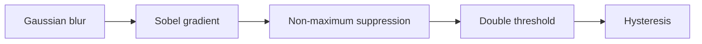

# Sobel and Canny Edge Detection with AVX2

CEPARCO SY2026-2027

**Group members:** _add names and the stages each person owns._

## Abstract

This project implements Sobel and Canny edge detection on 8-bit grayscale images in x86-64 assembly using AVX2, next to a scalar C baseline. Sobel and the blur, gradient, non-maximum suppression and double-threshold stages of Canny apply the same arithmetic to every pixel, so they map onto vector operations that process 16 pixels at a time. Hysteresis follows chains of pixels and is treated as the hard case. Each AVX2 stage is checked against its scalar version for identical output, and the project reports time and speedup for each stage and for the whole pipeline.

## Description

### Inputs

- A PNG image (`input.png`), read with stb_image and converted to 8-bit grayscale when it is loaded. The width and height come from the file.
- For Canny: the low and high thresholds and the Gaussian kernel.

### Outputs

- The Sobel edge image (0–255), written as a PNG (`output.png`), from the scalar and the AVX2 versions.
- The Canny edge map from the scalar and the AVX2 versions.
- A mismatch report: the number of differing pixels per stage, and the first mismatch.
- A timing table of scalar time, AVX2 time and speedup for each stage and the whole pipeline.

## Algorithms

### Sobel

For a pixel `e` with the 3×3 neighbourhood

```
a b c
d e f
g h i
```

Sobel measures the horizontal and vertical change in brightness around `e`. The output pixel is the combined size of the two changes, capped at 255, and is written to a separate buffer.

$$
\begin{aligned}
G_x &= (c + 2f + i) - (a + 2d + g) \\
G_y &= (g + 2h + i) - (a + 2b + c) \\
e_{out} &= \min(255,\ |G_x| + |G_y|)
\end{aligned}
$$

### Canny

Canny blurs the image, finds the gradient with Sobel, then thins and links the edges in five stages:



1. **Gaussian blur** smooths noise so small speckles do not become edges.
2. **Sobel gradient** gives the edge strength and direction at each pixel.
3. **Non-maximum suppression** keeps only pixels that are local maxima along the gradient direction, thinning edges to one pixel wide.
4. **Double threshold** marks pixels above the high threshold as strong, between the two thresholds as weak, and below the low threshold as none.
5. **Hysteresis** keeps a weak pixel only if it connects to a strong one.

## Parallelization plan

Each vector step handles 16 output pixels at once: a `ymm` register holds 16 `int16` values, which is enough room for every Sobel intermediate. The 256-bit integer instructions below need AVX2; the original AVX only widened floating-point operations to 256 bits.

| Step | Instruction | Why |
| --- | --- | --- |
| Load and widen 16 pixels | `vpmovzxbw ymm, m128` | Reads 16 `uint8` pixels and widens them to `int16` in one instruction |
| Left, centre and right neighbours | three loads at x−1, x, x+1 | Unaligned loads replace any shuffling |
| Weight of 2 | `vpaddw` of a value with itself | Doubles the middle row or column term |
| Gx and Gy sums | `vpaddw`, `vpsubw` | Gx and Gy stay within −1020 to 1020, so `int16` never overflows |
| Absolute value | `vpabsw` | Gives abs(Gx) and abs(Gy) |
| abs(Gx) + abs(Gy) | `vpaddw` | Largest value is 2040, still within `int16` |
| Clamp to 255 and narrow | `vpackuswb` | Saturates `int16` to 0–255 as it narrows to `uint8` |
| Restore pixel order | `vpermq` | The pack works inside each 128-bit lane, so the two halves come out interleaved |

- **Borders.** The first version leaves the output border at 0 (skip), and the scalar reference does the same so the two compare exactly. Zero, replicate and reflect are options to add later.
- **Tail pixels.** When the width is not a multiple of 16, the last partial block is finished by the scalar loop.
- **Buffers.** Input and output are separate arrays, so a row is never overwritten while a neighbouring row still needs it.

Sobel comes first because every later stage reuses its widen, add and compare pattern. Hysteresis is the stage least likely to speed up.

| Stage | AVX2 approach | Difficulty |
| --- | --- | --- |
| Sobel | The steps in the table above, writing 16 pixels per iteration | Low |
| Gaussian blur | Separable integer kernel (for example 1 2 1): widen to `int16`, shift and add for the weights, divide by the kernel sum with a shift | Low |
| Gradient magnitude and direction | Keep abs(Gx) + abs(Gy) as `int16` without clamping. Quantize direction to four sectors by comparing abs(Gy) with abs(Gx) scaled by tan 22.5° and tan 67.5° and checking the sign of Gx × Gy, so no `atan2` is needed | Medium |
| Non-maximum suppression | Compute the neighbour comparison for all four directions, then select the right result per pixel with a direction mask (`vpblendvb`) | Medium to high |
| Double threshold | Two `vpcmpgtw` compares against the high and low thresholds, giving strong, weak and none masks | Low |
| Hysteresis | Start with a scalar flood fill from strong pixels. Then try repeated vector passes that promote weak pixels with a strong 3×3 neighbour until nothing changes, and compare the two | High |

## Target platform

- **Processor:** an x86-64 CPU with AVX2. The exact model is recorded with the benchmark results.
- **System and tools:** Windows 11, with Visual Studio for the C code and NASM for the assembly.
- **Languages:** C for PNG reading and writing (stb_image and stb_image_write), the scalar baseline, verification and timing; NASM x86-64 assembly for the AVX2 stages.

## Milestones

The weeks follow the course specification; the actual deadlines are on Canvas.

| Milestone | Week | What is delivered |
| --- | --- | --- |
| 1. Project proposal | 6 | This README as the proposal document, and a 5–8 minute video pitch |
| 2. Mid-project update demo | 10 | Image reading and writing, scalar and AVX2 Sobel matching each other and timed, and the first scalar Canny stages checked |
| 3. Complete submission and demo | 13 | AVX2 Canny stages matched to scalar, the filled benchmark table, source code, a discussion of the parallel algorithms, and the execution time comparison of sequential against parallel |

**Pitch video (milestone 1):** _add the link or file path here._

## Verification

Every AVX2 stage is checked against its scalar C version on the same input, and the two outputs must be identical byte for byte, because both use integer arithmetic only.

- **Compare each stage on its own.** Keep the intermediate buffer after each stage (blur, gradient, suppression, threshold) and compare it before moving on, so a mismatch points at one stage.
- **Report the difference.** Count the differing pixels and print the first mismatch with its x, y and both values.
- **Use an 8×8 hand-checked image first.** Its Sobel output can be worked out on paper using the letter-labelled 3×3 method above.
- **Cover the awkward sizes.** Include widths that are not a multiple of 16, a width under 16, and a very small image such as 3×3, so tail handling and border policy are both exercised.
- **Look at the pictures.** Write each result as an image file and view it next to the input, since a plausible-looking number check can still hide a flipped sign or shifted row.

## Benchmarks

Each stage and the whole pipeline are timed for the scalar and the AVX2 version on the same image. Speedup = scalar time / AVX2 time. Only the processing is timed, not loading or saving the image.

Results (fill in for each image size tested):

| Stage | Scalar time (ms) | AVX2 time (ms) | Speedup |
| --- | --- | --- | --- |
| Sobel |  |  |  |
| Gaussian blur |  |  |  |
| Gradient magnitude and direction |  |  |  |
| Non-maximum suppression |  |  |  |
| Double threshold |  |  |  |
| Hysteresis |  |  |  |
| Whole Canny pipeline |  |  |  |

## Build and run


## Roadmap

- [x] Read and write PNG images in C (stb_image and stb_image_write)
- [x] Scalar Sobel in `main.c`
- [ ] Build the 8×8 hand-checked test image and check the scalar Sobel against the paper result
- [ ] AVX2 Sobel, matched to the scalar version, then timed
- [ ] Scalar Canny stages, each checked on its own
- [ ] AVX2 Canny stages, each matched to its scalar stage before starting the next
- [ ] Benchmark on all test images and fill in the results table
- [ ] Write up the results and what limited the speedup

## References
